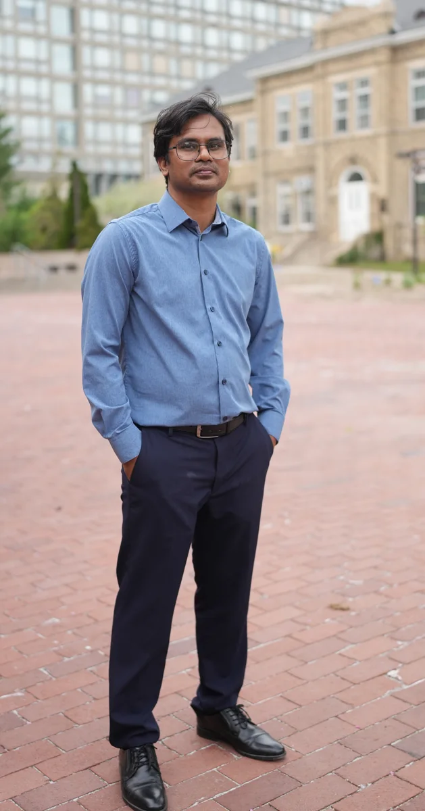

Postdoctoral Scholar · University of Guelph

<h1>Md Bodrud-Doza, PhD</h1>

Environmental and geospatial scientist

<a href="https://geg.uoguelph.ca/">Department of Geography, Environment and Geomatics</a> · <a href="https://www.uoguelph.ca/">University of Guelph</a>, Ontario, Canada

I work out where conservation actions can improve water quality while keeping agricultural land productive.

My research combines watershed modelling, geospatial analysis and machine learning with the priorities of the people who manage the land. It builds on a PhD in precision conservation for tile-drained watersheds and on earlier work in climate adaptation and science–policy practice.

<a class="button primary" href="research.qmd">Explore research</a><a class="button secondary" href="cv.qmd">Academic CV</a><a class="text-link" href="teaching.qmd">Teaching and mentoring →</a>

<figure class="hero-photo">

<figcaption>University of Guelph · Ontario, Canada</figcaption></figure>

<dl class="summary-strip glance">
<dt>Position</dt><dd>Postdoctoral Scholar, University of Guelph (2026–present). PhD in Geography, University of Guelph, 2026.</dd>

<dt>Expertise</dt><dd>Agricultural water quality · Precision conservation · Watershed modelling · GIS and machine learning</dd>



<dt>Teaching</dt><dd>Graduate Teaching Assistant in undergraduate physical geography and GIS courses, 2022–2024. <a href="teaching.qmd">Teaching →</a></dd>
</dl>

## Research program

One question runs through my work: how can agricultural landscapes stay productive while protecting water, soil and ecosystems? I am developing the answer as a research program, the [REAL Decision Lab](research.qmd), built on three connected pillars.

<article class="research-card">
Established foundation
<h3>Precision conservation and agricultural watershed science</h3>
Nutrient transport, tile drainage, conservation-practice evaluation and field-scale targeting, informed by local priorities.
</article><article class="research-card">
Established methods · emerging applications
<h3>Environmental intelligence: GIS, Earth observation and GeoAI</h3>
Spatial analysis and machine learning are established parts of my work. Satellite observation and GeoAI are directions I am building.
</article><article class="research-card">
Developing direction
<h3>Resilient agricultural landscapes and adaptive decision support</h3>
Multi-benefit conservation, climate adaptation and decision tools that are updated as monitoring shows what worked.
</article>

<a href="research.qmd#research-pillars">How the pillars connect, and the five-year plan →</a>

## Research case studies

<ul class="case-links"><li>Completed · published<a href="projects.qmd#precision-conservation">Precision conservation in tile-drained agricultural watersheds</a>PhD research: four first-authored papers on where, and which, conservation practices to prioritise.</li><li>Active · Mitacs Accelerate<a href="projects.qmd#healthy-lake-huron">Healthy Lake Huron: monitoring, modelling and conservation decision support</a>Postdoctoral project with conservation-authority partners. Outputs are planned, not yet delivered.</li><li>Developing<a href="projects.qmd#environmental-intelligence">Environmental intelligence and resilient agricultural landscapes</a>The longer-term questions that link monitoring, prediction and adaptive management.</li></ul>

## Selected publications



<a href="publications.qmd">Selected papers and the complete publication record →</a>

## Teaching, recognition and service

<article class="research-card"><h3>Teaching</h3>
I led laboratories and supported assessment in undergraduate physical geography and GIS courses at Guelph. In the Winter 2024 GIS and Spatial Analysis evaluation, 13 of 14 respondents agreed that I presented material clearly.
<a class="project-link" href="teaching.qmd">Philosophy, courses and student feedback →</a></article><article class="research-card"><h3>Recognition</h3>
Ontario Graduate Scholarship (2025–2026), Cecil H. Franklin Graduate Scholarship in Soil &amp; Water Conservation (2025), and GEG Graduate Publication Awards (2024, 2025).
<a class="project-link" href="cv.qmd#selected-awards">All awards →</a></article><article class="research-card"><h3>Service and leadership</h3>
Journal peer reviewer; graduate-student member of a University of Guelph faculty search committee (2023); earlier program leadership at BRAC and ICCCAD in Bangladesh.
<a class="project-link" href="experience.qmd">Professional experience →</a></article>

## Updates



<h2>Get in touch</h2>
I welcome conversations about research collaboration, graduate research, teaching and applied environmental projects.
<a class="button primary" href="contact.qmd">Contact</a><a class="text-link" href="collaboration.qmd">Collaboration interests →</a><a class="text-link" href="https://scholar.google.com/citations?user=1VymNoIAAAAJ&amp;hl=en">Google Scholar ↗</a>

