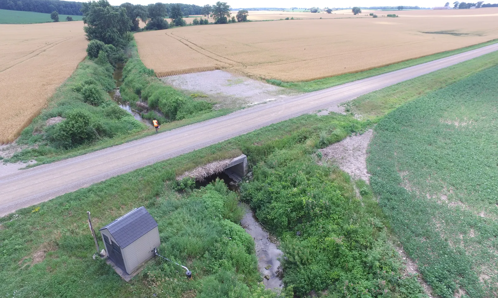

Postdoctoral Scholar · University of Guelph

<h1>Md Bodrud-Doza, PhD</h1>

Environmental and geospatial scientist

<a href="https://geg.uoguelph.ca/">Department of Geography, Environment and Geomatics</a> · <a href="https://www.uoguelph.ca/">University of Guelph</a>, Ontario, Canada

Clean water, sustainable landscapes and resilient food systems depend on the same thing: good decisions about how land is managed. My research builds the evidence for those decisions.

I am a geographer who builds watershed models, maps and machine-learning tools that show conservation agencies where limited budgets will do the most good. Before my PhD I spent six years designing and managing climate-adaptation programs in Bangladesh. That is why my science starts from a practical test: will this work on a real farm, for the people who have to carry it out?

<a class="button primary" href="research.qmd">Explore research</a><a class="button secondary" href="cv.qmd">Academic CV</a><a class="text-link" href="teaching.qmd">Teaching and mentoring →</a>

<figure class="hero-photo">

<figcaption>University of Guelph · Ontario, Canada</figcaption></figure>

<dl class="summary-strip glance">
<dt>Position</dt><dd>Postdoctoral Scholar, University of Guelph (2026–present). PhD in Geography, University of Guelph, 2026.</dd>

<dt>Expertise</dt><dd>Agricultural water quality · Precision conservation · Watershed modelling · GIS and machine learning</dd>



<dt>Teaching</dt><dd>Graduate Teaching Assistant in undergraduate physical geography and GIS courses, 2022–2024. <a href="teaching.qmd">Teaching →</a></dd>
</dl>

## Decision science, from problem to solution {#problem-to-solution}

<figure class="field-banner"><figcaption>Where the research starts: a monitored stream running between cropland. What leaves these fields in a storm ends up downstream.</figcaption></figure>

<ol class="pitch"><li>
The problem
<h3>Nutrients lost from farmland feed algal blooms</h3>
Conservation practices such as cover crops, buffers and drainage-water management reduce those losses, but only when they are put in the right place.
</li><li>
What I do
<h3>Rank fields and practices with models and data</h3>
I combine monitoring records, process-based watershed models and machine learning, then adjust the ranking with what local farmers and conservation staff know.
</li><li>
Why it matters
<h3>Funding goes where it achieves most</h3>
Agencies can direct stewardship budgets to the fields that count and explain that choice to the producers they work with.
</li></ol>

## Research program

Three connected pillars make up the program I am developing, the [REAL Decision Lab](research.qmd). The first is established and published; the third is where the work is heading.

<article class="research-card">
Established foundation
<h3>Precision conservation and agricultural watershed science</h3>
Nutrient transport, tile drainage, conservation-practice evaluation and field-scale targeting, informed by local priorities.
</article><article class="research-card">
Established methods · emerging applications
<h3>Environmental intelligence: GIS, Earth observation and GeoAI</h3>
Spatial analysis and machine learning are established parts of my work. Satellite observation and GeoAI are directions I am building.
</article><article class="research-card">
Developing direction
<h3>Resilient agricultural landscapes and adaptive decision support</h3>
Multi-benefit conservation, climate adaptation and decision tools that are updated as monitoring shows what worked.
</article>

<a href="research.qmd#research-pillars">How the pillars connect, and the five-year plan →</a>

## Research case studies

<ul class="case-links"><li>Completed · published<a href="projects.qmd#precision-conservation">Precision conservation in tile-drained agricultural watersheds</a>PhD research: four first-authored papers on where, and which, conservation practices to prioritise.</li><li>Active · Mitacs Accelerate<a href="projects.qmd#healthy-lake-huron">Healthy Lake Huron: monitoring, modelling and conservation decision support</a>Postdoctoral project with conservation-authority partners. Outputs are planned, not yet delivered.</li><li>Developing<a href="projects.qmd#environmental-intelligence">Environmental intelligence and resilient agricultural landscapes</a>The longer-term questions that link monitoring, prediction and adaptive management.</li></ul>

## From field practice to predictive science {#career-path}

I did not come to watershed modelling by the usual route. I trained as an environmental scientist, worked for six years where climate decisions are made and paid for, and then returned to research to build better evidence for those decisions.

<ol class="career-path"><li>2010–2014<strong>Environmental sciences</strong>BSc and MSc, Jahangirnagar University. Groundwater quality, GIS and geostatistics.</li><li>2016–2018<strong>Adaptation research</strong>Research Officer, ICCCAD. Climate-adaptation and policy research.</li><li>2018–2022<strong>Program leadership</strong>BRAC and ICCCAD. Climate-resilience programs, partnerships and proposals.</li><li>2022–2026<strong>PhD in Geography</strong>University of Guelph. Precision conservation in tile-drained watersheds.</li><li class="path-now">2026–present<strong>Postdoctoral Scholar</strong>University of Guelph. Healthy Lake Huron monitoring, modelling and decision support.</li></ol>

<a href="research-journey.qmd">Research journey →</a> · <a href="experience.qmd">Professional experience →</a>

## Selected publications



<a href="publications.qmd">Selected papers and the complete publication record →</a>

## Teaching, recognition and service

<article class="research-card"><h3>Teaching</h3>
I led laboratories and supported assessment in undergraduate physical geography and GIS courses at Guelph. In the Winter 2024 GIS and Spatial Analysis evaluation, 13 of 14 respondents agreed that I presented material clearly.
<a class="project-link" href="teaching.qmd">Philosophy, courses and student feedback →</a></article><article class="research-card"><h3>Recognition</h3>
Ontario Graduate Scholarship (2025–2026), Cecil H. Franklin Graduate Scholarship in Soil &amp; Water Conservation (2025), and GEG Graduate Publication Awards (2024, 2025).
<a class="project-link" href="cv.qmd#selected-awards">All awards →</a></article><article class="research-card"><h3>Service and leadership</h3>
Journal peer reviewer; graduate-student member of a University of Guelph faculty search committee (2023); earlier program leadership at BRAC and ICCCAD in Bangladesh.
<a class="project-link" href="experience.qmd">Professional experience →</a></article>

## Updates



<h2>Working on water, land or food systems?</h2>
I am glad to talk about research collaboration, graduate research, teaching and applied environmental projects, and to share my teaching dossier with search committees.
<a class="button primary" href="contact.qmd">Get in touch</a><a class="text-link" href="collaboration.qmd">Collaboration interests →</a><a class="text-link" href="https://scholar.google.com/citations?user=1VymNoIAAAAJ&amp;hl=en">Google Scholar ↗</a>

