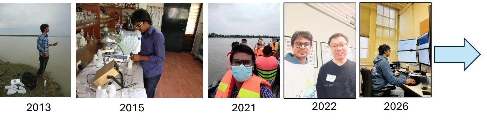

My research has moved from measuring environmental problems, to understanding how people adapt to them, to predicting where action will do the most good.

I began by measuring and mapping water quality in Bangladesh, using field sampling, laboratory analysis, GIS and geostatistics to show where groundwater and surface water put people at risk. Working with ICCCAD and BRAC then turned my attention to climate adaptation and resilience, and to how evidence reaches policy and practice. My doctoral research at the University of Guelph brought the two together in precision conservation: watershed modelling and machine learning to decide where conservation practices should go in agricultural landscapes. Each stage added methods to the one before, and the publications below follow that path.

<figure class="evidence-photo journey-image"><figcaption>2013–2026 · From water sampling and laboratory analysis to applied fieldwork and computational research. <a href="research-journey.qmd">Research journey →</a></figcaption></figure>

Peer-reviewed research, other scholarly outputs and public writing are listed separately below. For current citation information, visit [Google Scholar](https://scholar.google.com/citations?user=1VymNoIAAAAJ&hl=en) or [ORCID](https://orcid.org/0000-0003-4694-4077).



<nav class="page-shortcuts" aria-label="Publications sections"><a href="#featured-research">Selected publications</a><a href="#research-publication-timeline">Research timeline</a><a href="#publication-record">Complete record and search</a></nav>

## Selected publications {#featured-research}

Peer-reviewed research

These papers are the most relevant to my current research. The first four report my doctoral work on precision conservation. The last two show the earlier foundations in groundwater-quality assessment and in climate adaptation.



## Research & Publication Timeline {#research-publication-timeline}

My publication record has developed through overlapping research domains, from environmental quality and spatial analysis to climate resilience, agricultural water quality, and precision conservation.



## Complete Publication Record {#publication-record}

Browse journal articles, book chapters, working papers, conference abstracts, technical reports, and public and policy writing. Use the search box and filters to narrow the list.


