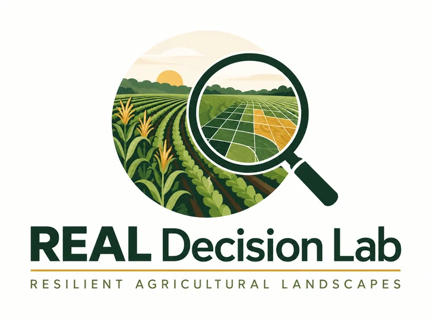

Research program

<h1>Research</h1>

REAL Decision Lab · Resilient Agricultural Landscapes Decision Lab

A developing research program. It is the framework for my current and planned work, not yet a staffed laboratory.

How can agricultural landscapes remain productive while protecting water, soil and ecosystems? Conservation practices such as cover crops, buffers and drainage-water management can reduce nutrient losses, but how well they work depends on where they are placed and whether they suit the farm. My research identifies where conservation actions are likely to matter most, tests those choices with models and monitoring data, and turns the results into tools that conservation staff and producers can use.

<nav class="page-shortcuts" aria-label="Research sections"><a href="#research-pillars">Three pillars</a><a href="#four-connected-research-areas">How they connect</a><a href="#current-and-developing-projects">Status of the work</a><a href="#five-year-program">Five-year plan</a><a href="#case-studies">Case studies</a></nav>

## Three connected pillars {#research-pillars}

<article class="pillar">
Pillar 1 · Established foundation
<h3>Precision conservation and agricultural watershed science</h3>
My doctoral research asked where conservation practices should go in tile-drained agricultural watersheds, and which practices suit which fields. It covers nutrient transport and tile drainage, evaluation of beneficial management practices (BMPs), field-scale targeting, and ways to adjust priorities to local needs.

<strong>Evidence:</strong> four first-authored papers (2023–2026) and a completed PhD thesis. <a href="projects.qmd#precision-conservation">Case study →</a>
</article>
<article class="pillar">
Pillar 2 · Established methods, emerging applications
<h3>Environmental intelligence through GIS, Earth observation and GeoAI</h3>
GIS, geostatistics and machine learning are established parts of my published work, from groundwater-quality mapping to field-level conservation prioritisation. I am now extending these methods to satellite observation and GeoAI (AI for geographic data), so that monitoring and prediction can cover larger areas and update more often.

<strong>Evidence:</strong> published spatial-analysis and machine-learning studies. Earth observation and GeoAI are emerging areas in which I have training but no publications yet.
</article>
<article class="pillar">
Pillar 3 · Developing direction
<h3>Resilient agricultural landscapes and adaptive decision support</h3>
The first two pillars answer where and what. This pillar asks what to do next as conditions change: how to weigh water quality against production, cost and climate risk, and how to revise plans as monitoring shows what worked. Food-system stress testing and anticipatory decision-making are developing ideas within it.

<strong>Evidence:</strong> the active Healthy Lake Huron project, earlier professional work and publications in climate adaptation, and a submitted award application. No funded food-system project exists yet.
</article>

## How the pillars connect {#four-connected-research-areas}

The pillars are stages of one cycle. Observation and analysis (Pillar 2) explain what is changing and why. Precision conservation (Pillar 1) uses that understanding to plan what to do, and where. Adaptive decision support (Pillar 3) checks the outcome and updates the plan. The REAL Decision Lab framework sets this out as four steps with a return loop.

<ol class="framework-stages">
<li id="area-observe">01 · OBSERVE<h3>Landscape Monitoring &amp; Earth Observation</h3>
What is changing, where, and when?

Connect long-term monitoring, field observations, satellite imagery, and geospatial data.
</li>
<li id="area-understand">02 · UNDERSTAND<h3>Environmental Processes, Modelling &amp; GeoAI</h3>
Why is it changing?

Use process-based models and GeoAI—AI for geographic data—to explain patterns, pathways, and risk.
</li>
<li id="area-design">03 · PLAN<h3>Precision &amp; Multi-Benefit Conservation</h3>
What should be done, and where?

Compare conservation options for water quality, ecosystems, production, cost, and resilience.
</li>
<li id="area-learn">04 · DECIDE &amp; LEARN<h3>Adaptive Decision Support &amp; Learning</h3>
What worked, and what should change next?

Use indicators, practical decision-support tools, monitoring, and evaluation to update priorities.
</li>
</ol>
<svg viewBox="0 0 1000 80" role="img" aria-labelledby="loop-title"><title id="loop-title">Adaptive return from Area 4 to Area 1: Monitor outcomes, compare results with expectations, learn, update models and priorities, and observe again.</title><defs><marker id="loop-arrow" viewBox="0 0 10 10" refX="5" refY="5" markerWidth="6" markerHeight="6" orient="auto-start-reverse"><path d="M 0 0 L 10 5 L 0 10 z" fill="currentColor"/></marker></defs><path d="M 930 5 V 20 Q 930 62 888 62 H 112 Q 70 62 70 20 V 5" fill="none" stroke="currentColor" stroke-width="3" marker-end="url(#loop-arrow)"/></svg>
Adaptive learning · Area 4 → Area 1
<ol class="loop-steps"><li>Monitor outcomes</li><li>Compare results with expectations</li><li>Learn</li><li>Update models and priorities</li><li>Observe again</li></ol><a class="return-link" href="#area-observe">↑ Return to Area 1: Observe</a>

<strong>Shared outcomes</strong>Water quality · Healthy soils and ecosystems · Resilient production · Climate resilience

## Status of the work {#current-and-developing-projects}

Each item below is labelled by what it is: finished and published, funded and under way, submitted and awaiting a decision, or an idea still in development.

<section><h3>Completed · published</h3><ul><li><strong>Precision conservation in tile-drained agricultural watersheds.</strong> PhD research, University of Guelph, 2022–2026, supported by Environment and Climate Change Canada project funding (2024–2026). Four first-authored papers. <a href="projects.qmd#precision-conservation">Case study →</a></li><li><strong>Environmental quality, groundwater and spatial risk.</strong> Earlier peer-reviewed work in Bangladesh using GIS, geostatistics and multivariate statistics. <a href="publications.qmd#publication-record">Publication record →</a></li><li><strong>Climate adaptation and resilience.</strong> Peer-reviewed articles, working papers and policy outputs from my work at ICCCAD and BRAC. <a href="research-journey.qmd">Research journey →</a></li></ul></section>
<section id="current-project-healthy-lake-huron"><h3>Active · funded</h3><ul><li><strong>Healthy Lake Huron: monitoring, modelling and conservation decision support.</strong> Mitacs Accelerate postdoctoral project, September 2026–present, with <a href="https://healthylakehuron.ca/">Healthy Lake Huron partners</a>. Ausable Bayfield Conservation Authority (ABCA) is the formal Mitacs partner. I hold the postdoctoral position; the conservation-priority maps, indicator scorecards and monitoring recommendations are planned outputs. <a href="projects.qmd#healthy-lake-huron">Case study →</a></li></ul></section>
<section><h3>Submitted · not confirmed</h3><ul><li><strong>Field-specific precision conservation in Ontario’s Lake Erie Basin.</strong> OMAFA proposal led by Dr. Prasad Daggupati, to which I contributed. It would extend my PhD research. Under review; funding is not confirmed. <a href="collaboration.qmd#omafa-precision-conservation-proposal" aria-label="Details of the OMAFA precision-conservation proposal">Details →</a></li><li><strong>Food-system resilience and anticipatory decision-making.</strong> My application to the Canada Postdoctoral Research Award (CPRA) program. Submitted; no award is confirmed. <a href="collaboration.qmd#food-system-resilience-and-anticipatory-decision-making" aria-label="Details of the food-system resilience direction">Details →</a></li></ul></section>
<section><h3>Developing ideas</h3><ul><li><strong>Earth observation and GeoAI for agricultural landscapes.</strong> Extending established geospatial and modelling methods to satellite time series. No funded project or publication yet.</li><li><strong>Adaptive, multi-benefit decision support.</strong> Linking monitoring, models and indicators so that conservation plans can be revised as evidence accumulates. <a href="projects.qmd#environmental-intelligence">Case study →</a></li></ul></section>

## A five-year research program {#five-year-program}

This is a plan, not a record. It shows how the published foundation and the current project could grow into an independent program, in steps that each produce results on their own.

<ol class="plan-phases">
<li>
Years 1–2 · Consolidate
<h3>From watershed evidence to transferable tools</h3>
Complete the Healthy Lake Huron project and publish its monitoring, modelling and indicator results. Test whether the field-prioritisation approach from my PhD transfers to other Great Lakes watersheds with different drainage and data conditions.
</li>
<li>
Years 2–4 · Extend
<h3>Wider and more frequent observation</h3>
Add satellite time series and GeoAI to track cover, drainage and practice adoption across whole regions, and compare what these observations show with what process-based models predict. This step would support the first graduate student projects.
</li>
<li>
Years 3–5 · Integrate
<h3>Adaptive, multi-benefit decision support</h3>
Bring monitoring, prediction and planning into decision tools that weigh water quality with production, cost and climate risk, developed with conservation agencies and producers. Begin comparative work on food-system resilience, including Canada–Bangladesh comparisons.
</li>
</ol>

Why this is achievable: the first step is already funded and under way; the methods in the second build on tools I already use; and the third relies on partnerships with conservation authorities and on my earlier experience developing programs with agencies and communities. I plan to seek federal and provincial research funding and partner-linked funding to support it. None of that future funding has been applied for or awarded except where listed above.

## Case studies {#case-studies}

<ul class="case-links"><li>Completed · published<a href="projects.qmd#precision-conservation">Precision conservation in tile-drained agricultural watersheds</a>The problem, methods, published findings and my role in the PhD research.</li><li>Active · Mitacs Accelerate<a href="projects.qmd#healthy-lake-huron">Healthy Lake Huron: monitoring, modelling and conservation decision support</a>Partner roles, methods, workplan and planned deliverables.</li><li>Developing<a href="projects.qmd#environmental-intelligence">Environmental intelligence and resilient agricultural landscapes</a>The research questions behind the longer-term program.</li></ul>

## Methods and foundations

My established work combines GIS, environmental monitoring, machine learning, and watershed modelling. Earth observation and GeoAI are growing directions. Spatial optimisation means comparing where conservation actions could provide the greatest benefits within available resources and other constraints.

GIS &amp; geostatisticsEnvironmental monitoringMachine learningWatershed modellingSpatial optimisationMulti-criteria decision analysis

[Read the published research →](publications.qmd) · [How the research developed →](research-journey.qmd) · [Discuss a collaboration →](collaboration.qmd)
